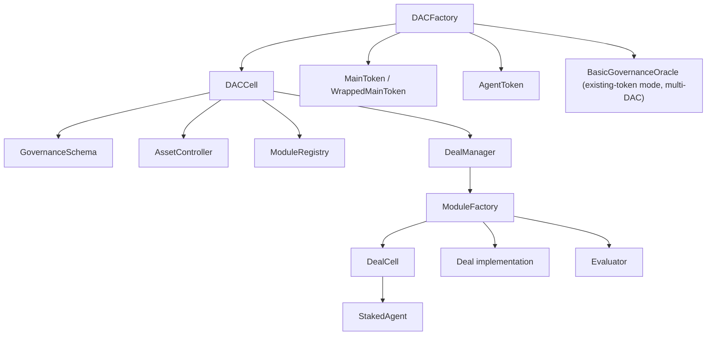

# DAC Cloud Contract Inventory

Updated: May 11, 2026

For the architectural overview, see [architecture.md](architecture.md). For scripts and manifests, see [development.md](development.md).

## 1. Current Topology

## 2. DAC Deployment Contracts

### `src/kernel/DACFactory.sol`

Protocol bootstrap contract.

Current responsibilities:

- deploy native DACs through `deployDAC(...)`
- deploy existing-token DACs through `deployExistingTokenDAC(...)`
- predict deterministic DAC addresses, bound to the deployer: the CREATE2 salt is `deploymentSalt(deployer, salt) = keccak256(abi.encode(deployer, salt))`
- deploy wrapper/oracle primitives for existing-token mode
- seed wrapped treasury balances for existing-token DACs
- emit `DACDeployed` and `ExistingTokenDACDeployed`

### `src/kernel/libraries/DACDeployment.sol`

Helper library used for deterministic address prediction.

## 3. DAC Kernel Contracts

### `src/kernel/DACCell.sol`

DAC micro-kernel.

Current responsibilities:

- DAC metadata
- pointers to:
  - main token
  - agent token
  - deal manager
  - module registry
  - asset controller
  - governance schema
- DAC proposal creation and execution routing
- legal-wrapper message logging
- root capital-call bootstrap in native mode
- asset-controller treasury sync entrypoints
- DAC-level event emission

### `src/kernel/DealManager.sol`

Deal lifecycle controller.

Current responsibilities:

- create deals through approved modules
- keep the deal registry
- keep per-deal state and evaluator registry
- approve funding and tranches
- route evaluator output
- determine recoverability / active lifecycle state
- interact with the asset controller for reward and main-asset accounting
- validate the proposer-supplied deal-proposal factory against the module (`dealAcceptsGovernanceFactory`); reject deals whose factory the module does not vouch for
- reward claims (`mintMain`) and `onDealClosed` are gated on deal-cell identity only, never on the module's `isActive()`: a module going dormant cannot freeze rewards already unlocked or the close that releases the DAC's reservations
- gate controlled addresses: the `Deal` a module returns is registered only if it is a contract bound to the deal cell being created (`getCell()`) that has never delegated; beyond the kernel-registered `DealCell` and `Deal`, a module may register at most `MAX_MODULE_CONTROLLED_ADDRESSES` (3) per deal, contract accounts only (no EOAs, no EIP-7702 delegated EOAs) that have never delegated
- gate evaluation per deal: until a deal's `evaluationDeadline` only holders of stake in that deal may evaluate it; after it, any main-token holder or agent of the DAC
- notify a deal's evaluators when the DAC approves it (`IEvaluatorActivation.onDealActivated`, optional, isolated, gas-capped)
- release the unclaimed remainder of a dividend payout after its claim window (`sweepDividend`, open to anyone)

### `src/kernel/DealCell.sol`

Per-deal state shell.

Current responsibilities:

- holds generic deal state
- staking bridge between `AgentToken` and `StakedAgent`
- enforces `agentsLimit` (maximum number of stakers per deal)
- enforces `minimalStake` (minimum stake amount per agent)
- enforces the kernel's own staking rules: a stake is never zero, and a deal admits at most `GovernanceLimits.MAX_DEAL_HOLDERS` (100) distinct stakers over its lifetime (`holdersCount()` reports the list's length; a governance-appointed liquidator is exempt)
- records `approvedAt`, the time the DAC approved the deal, for evaluators to measure from
- closes regardless of the module: the close hook runs with a guaranteed gas stipend and a failure is reported through `DealCloseHookFailed`
- returns capital one funding token at a time, each in an isolated, gas-capped call; a token that cannot move is reported through `CapitalReturnFailed` and skipped
- tranche state
- whitelist / early-return state
- reward distribution state
- deal reward-pool split and deal-owned reward claim state
- recovery state
- generic deal-governance dispatch before forwarding module-specific behavior

### `src/kernel/Deal.sol`

Abstract module execution contract.

Current responsibilities:

- deal-level proposal execution routing
- generic lifecycle hooks
- module-specific logic extension surface
- standardized `DealRelatedContract` discovery helper
- generic claim entrypoint for deal-owned reward pools via `claimDealRewardPool(...)`
- `getCell()`, the deal cell the deal is bound to; the binding (`joinDac`) is set once by the deal's factory and the kernel checks it before registering the deal

The deal contract intentionally stays lean; DAC challenge state lives on deal proposal contracts instead of in `Deal`.

## 4. Governance Boundary Contracts

### `src/interfaces/IGovernanceSchema.sol`

Common DAC governance policy interface.

Main methods:

- create/consume DAC proposals
- set/get voting config
- set/get deal-creation config
- set/get governance strategy config
- set/get governance oracle

### `src/kernel/governance/NativeGovernanceSchema.sol`

Native DAC governance policy.

Uses:

- `MainToken` delegated votes for qualification, read at the second before proposal creation against the votable supply of that same second
- `VotingConfig` for native DAC proposal rules

Handles:

- proposal-type gating
- validation of native voting config (`VotingConfigLib`)
- capability-aware proposal support via the asset controller
- the creator's commitment: the qualifying votes (for `CAST_VETO_DEAL` at least 0.1% of votable supply) are vote-locked on the creator for the proposal's voting period
- capital-call proposals: the data carries an expiry that must lie in the future

### `src/kernel/governance/HybridGovernanceSchema.sol`

Existing-token DAC governance policy.

Uses:

- `WrappedMainToken` delegated votes for qualification, read at the second before proposal creation against the wrapped votable supply of that same second
- `GovernanceStrategyConfig` for oracle/fallback behavior (every duration, warmup included, is in seconds and capped by `GovernanceLimits.MAX_DURATION`, so a passed config can never brick proposal creation)
- `GovernanceOracle` address management (a non-zero oracle must be a contract)

Handles:

- hybrid proposal deployment
- oracle-based governance strategy validation
- wrapped-only bootstrap mode when `oraclePrimaryEnabled == false`
- blocking behavior toggles for all proposals / high-quorum proposals
- fallback warmup, fallback duration and execution-validity configuration, all in seconds
- vote retention: `voteRetentionPercent` (share of a wrapped vote's weight that must still be delegated to the voter when it votes) and `voteLockDuration` (how long that share then stays vote-locked)
- relays vote locks from its own proposals to the wrapped token (`lockVotes`, callable by proposals this schema deployed only)
- the creator's commitment: the qualifying votes are vote-locked on the creator until the proposal's longest scheduled voting path has ended
- capability-aware proposal support via the asset controller

### `src/kernel/governance/BasicGovernanceOracle.sol`

Reference oracle publisher for hybrid DAC governance. A single instance can serve any number of DACs — snapshots and active state are namespaced per DAC.

Features:

- admin-controlled publisher set
- proposal-specific snapshot publication, keyed by `(dac, proposalId)`
- per-DAC deactivation (one DAC can be turned off without affecting others sharing the oracle)
- indexer-facing publisher/deactivation events with the DAC address indexed
- separates the consumer-facing `IGovernanceOracle` (read-only) from the operator-facing `IBasicGovernanceOracle` so future implementations (optimistic, ZK, multi-publisher) can drop in without consumer changes

### `src/kernel/governance/Proposal.sol`

Shared base for timestamp-based proposal resolution and execution validity.

Current shared behaviors:

- vote casting
- resolution logic
- blocking quorum logic
- execution-validity window
- executable / expired / executed state

`snapshotTime` is the second before creation; the creator supplies the electorate as of that same second. Voting opens the second after creation (`VotingNotStarted` before). `resolutionTime` is the time of the deciding vote, or the end of voting when the proposal resolves because its period ran out, whenever that is first observed.

### `src/kernel/governance/DACManagementProposal.sol`

Native DAC proposal contract.

Uses:

- `MainToken` snapshot voting
- neutral proposal semantics
- no veto-specific behavior

### `src/kernel/governance/HybridDACManagementProposal.sol`

Existing-token DAC proposal contract.

Features:

- `AwaitingOracleSnapshot`
- `PrimaryVoting`
- `FallbackWarmup`
- `FallbackVoting`
- `Resolved`

Supports:

- wrapped voting
- Merkle voting
- emergency fallback after oracle deactivation
- execution-validity window after resolution

Phase times follow the strategy's durations and the oracle's publication time: primary voting runs from the snapshot's `publishedAt` for `duration`; fallback warmup runs from the oracle deadline for `fallbackWarmupDuration`; fallback voting runs from the fallback snapshot for `fallbackDuration`. Transitions are applied lazily by any vote or state read, always with the scheduled times, so a snapshot published in time is honoured without an activation call and an untouched proposal still expires on schedule. A timely snapshot stays binding if the oracle is switched off later; `triggerEmergencyFallback()` is then the way out of primary, with a fresh warmup from the trigger. Oracle reads are isolated and gas-capped: an oracle that fails to answer reads as "no snapshot, not active" and cannot freeze a proposal. A wrapped vote applies the strategy's vote retention: the retained share must still be delegated to the voter and is locked through the schema.

### `src/kernel/governance/DealManagementProposal.sol`

Deal-level proposal contract.

Uses:

- `StakedAgent` snapshot voting (weights and stake supply at the second before creation)
- challengeable-execution model
- execution-validity window

Stores:

- whether the proposal is DAC-challengeable
- the linked DAC challenge proposal, if any

This contract covers both voluntary and forced deal exits:

- `PERMIT_UNSTAKE`
- `STRIKE_OUT_AGENT`

### Governance factories

- `src/kernel/governance/factories/DACManagementProposalFactory.sol`
- `src/kernel/governance/factories/HybridDACManagementProposalFactory.sol`
- `src/kernel/governance/factories/DealManagementProposalFactory.sol`
- `src/kernel/governance/factories/NativeGovernanceSchemaFactory.sol`
- `src/kernel/governance/factories/HybridGovernanceSchemaFactory.sol`
- `src/kernel/governance/factories/GovernanceOracleFactory.sol`

These deploy the governance implementations through proxy-backed factory flows.

## 5. Treasury and Asset Boundary Contracts

### `src/interfaces/IAssetController.sol`

Common asset-controller interface.

Main responsibilities exposed at interface level:

- treasury deposits and treasury sync
- capital-call creation and fulfillment, with a per-call expiry (`getCapitalCallExpiry`)
- dividend payout registration and claim settlement (claims capped at the committed total, open for `GovernanceLimits.DIVIDEND_CLAIM_WINDOW`; `dividendClaimDeadline`, `sweepDividend`)
- the votable supply as of a past second (`getPastVotableSupply`), the base every proposal is measured against
- deal funding approval
- main reward settlement
- DAC-managed distributor registry for `AgentToken`
- mint/burn support
- vote delegation for DAC-held assets
- controlled-address registration
- votable-supply and obligation views
- capability introspection

### `src/kernel/controllers/NativeAssetController.sol`

Native DAC treasury and main-asset policy implementation.

Handles:

- main-token treasury accounting
- native main-token obligations
- dividend payout commitments (non-zero root and amount, claims capped at the committed total, a 365-day claim window, then a sweep of the remainder back to the free treasury)
- capital calls and treasury mints, both keeping max-supply headroom for outstanding reward obligations; a capital call cannot be fulfilled after its expiry
- controlled address registration
- released-votable accounting, checkpointed on every mint, burn and move that touches a controlled address so that proposals can read the votable supply of a past second
- treasury views: `treasuryBalance`, `committedBalance`, `freeBalance`
- DAC-managed `AgentToken` distributor allowances and recipient validation

### `src/kernel/controllers/ExistingTokenAssetController.sol`

Existing-token DAC treasury and wrapped-main-asset policy implementation.

Handles:

- wrapped treasury custody
- reserve-backed reward commitments
- reserve-backed dividend commitments, with the same claim window and sweep as native mode
- wrapped votable-supply exclusions, readable as of a past second
- wrapped move/delegate hooks
- reserve-backed capital calls from wrapped inventory, each with its expiry
- DAC-managed `AgentToken` distributor allowances and recipient validation

### Asset-controller factories

- `src/kernel/factories/AssetControllerFactory.sol`
- `src/kernel/factories/ExistingTokenAssetControllerFactory.sol`

## 6. Module Approval and Discovery

### `src/interfaces/IModuleRegistry.sol`

Minimal approved-module registry interface.

### `src/kernel/ModuleRegistry.sol`

Canonical DAC-owned approved-module storage.

### `src/interfaces/IModuleFactory.sol`

Module deployment and discovery interface.

`IModuleFactory.deployDeal` deploys only the `DealCell` and `Deal` for a given deal. `IModuleFactory.deployEvaluator` is called separately by the kernel to deploy the evaluator, allowing the evaluator to use a different module than the deal itself. Evaluator deployment is kernel-controlled.

Current discovery surface includes:

- `moduleId()`
- `moduleVersion()`
- `moduleManifestURI()`
- `supportedDealKinds()`
- `supportedEvaluatorKinds()`
- `supportsDealKind(...)`
- `supportsEvaluatorKind(...)`
- `supportsDealRewardPool(...)`

### `src/kernel/ModuleFactory.sol`

Abstract module factory base used by concrete modules.

## 7. Token Contracts

### `src/kernel/tokens/MainToken.sol`

Native DAC governance token.

- `ERC20Votes`
- capped supply
- mint/burn hooks routed through DAC-controlled components
- vote locks (`VoteLock`): the governance schema can pin an amount of an account's delegated votes until a timestamp; `lockedVotes(account)` reads the live lock
- wired to its deal manager once (`dacInit`)

### `src/kernel/tokens/WrappedMainToken.sol`

Existing-token DAC wrapper.

Features:

- 1:1 wrap / unwrap against an underlying ERC-20 (reentrancy guarded)
- `ERC20Votes`
- auto-self-delegation on first self-wrap (third-party `wrapTo` recipients delegate themselves)
- move/delegate notifications to the asset controller
- explicit `Wrapped` / `Unwrapped` events
- vote locks (`VoteLock`): a locked amount cannot be unwrapped, transferred or re-delegated until the lock ends
- wired to its asset controller once (`setController`)

### `src/kernel/tokens/VoteLock.sol`

Vote-lock mixin shared by `MainToken` and `WrappedMainToken`. A lock pins an amount of an account's delegated votes until a timestamp; while it is live, no transfer, burn, unwrap or re-delegation, by the account or by anyone delegating to it, may bring the account's votes below the locked amount. Only the DAC's governance schema can lock. Locks merge to the larger amount and the later expiry, never exceed the votes held when set, and never run longer than three years.

### `src/kernel/tokens/AgentToken.sol`

DAC operator token.

Used for:

- DAC-level operator issuance/revocation
- distributor inventory fanout into bound agent balances
- deal-creation anti-spam requirements
- staking into deals

Key semantics:

- distributor inventory is transferable only from DAC-approved distributor wallets
- distributed balances become bound / non-transferable at the recipient
- qualification-sensitive checks use `qualifiedBalanceOf(...)`, which excludes distributor inventory
- `transferFrom` (the path approved deals use to pull stake) requires a qualified balance, so distributor inventory can never enter a deal as stake
- a stake is never zero
- the `DealManager` holds the burner role only (it burns slashed stake); minting stays with the DAC cell

### `src/kernel/tokens/StakedAgent.sol`

Per-deal non-transferable `ERC20Votes` token used for deal governance. Self-delegates on mint, so a fresh stake carries voting and proposing power without a separate delegate call.

### Token factories

- `src/kernel/tokens/factories/TokenFactories.sol`
- `src/kernel/tokens/factories/WrappedMainTokenFactory.sol`

## 8. Proxy and Factory Infrastructure

### Proxy contract

- `src/kernel/proxies/UUPSProxy.sol`

The system uses proxy deployment for size and deployment-gas reasons, but the kernel/core-module deployment model remains operationally non-upgradeable.

### Core kernel factories

- `src/kernel/factories/DACCellFactory.sol`
- `src/kernel/factories/DealManagerFactory.sol`
- `src/kernel/factories/DealCellFactory.sol`
- `src/kernel/factories/ModuleRegistryFactory.sol`

## 9. Deal and Module Contracts

### `src/modules/core/CoreModuleFactory.sol`

Current shipped module factory.

Supports:

- `DACDeal`
- `TreasuryDeal`
- `AgentDeal`
- milestone evaluator
- revenue evaluator

The core module also declares reward-pool support through `supportsDealRewardPool(...)` for the `DACDeal` and `TreasuryDeal` kinds (`AgentDeal` does not use a deal reward pool).

Evaluator deployment is kernel-controlled and handled separately from deal deployment. The evaluator can use a different module factory than the deal, as specified by `DealParams.evaluatorModuleFactory`. `IModuleFactory.deployDeal` deploys only the `DealCell` and `Deal`; `IModuleFactory.deployEvaluator` is called separately by the kernel.

### `src/modules/core/CoreModuleDeals.sol`

Selector registry for the shipped core deal/evaluator kinds.

### `src/modules/core/governance/CoreDealManagementProposals.sol`

Core-module proposal selector registry for:

- treasury operations
- child-DAC operations
- external voting venue management (`APPROVE_VOTING_VENUE_VERSION`)
- external vote signature approvals (`EXTERNAL_VOTE_SIGN`)
- agent operations inside a host DAC (`HOST_STAKE`, `HOST_APPROVE_STAKE`, `HOST_CREATE_DEAL`, `HOST_CREATE_PROPOSAL`, `HOST_VOTE`, `HOST_CLAIM_REWARD`, `HOST_UNSTAKE`, `HOST_INVITE`, `RETURN_ASSET_TO_DAC`)

### `src/modules/core/governance/factories/CoreDealManagementProposalFactory.sol`

Quorum-policy factory for core module deal proposals.

## 10. Core Deal Implementations

### `src/modules/core/deals/DACDeal.sol`

Child-DAC deal implementation.

Capabilities:

- deploy/connect child DACs
- fulfill child capital calls
- create and vote child DAC proposals
- reinvest profits
- return profits
- send child equity home when the deal closes, and afterwards through `returnChildEquity()` for equity that was vote-locked in the child at close
- emit `DealRelatedContract` for child DAC and child token discovery
- approve external voting venue versions per staked-pig governance
- approve EIP-712 external vote payloads and serve them as ERC-1271 signatures (snapshot.org single-choice as the shipped venue)
- expose virtual hooks (`_executeExternalVoteSignExtension`, `_isValidSignatureExtension`) so forks can add new venues without modifying core paths

### `src/modules/core/deals/TreasuryDeal.sol`

Operational treasury deal.

Capabilities:

- direct spend governance
- Permit2 spend approvals
- agent spend/receive permissions
- vote delegation for treasury-held vote tokens
- profits recovery
- capital return one funding token at a time, isolated and gas-capped
- related treasury discovery event emission

### `src/modules/core/deals/Permit2Treasury.sol`

Treasury wallet owned by `TreasuryDeal`.

Features:

- direct spends
- Permit2 receive/spend support; the treasury's ERC-20 allowance to Permit2 is unlimited (`type(uint256).max`, which tokens with narrower allowances also accept) and Permit2's own per-spender allowance is the limit
- agent allowance enforcement
- capital return to the deal

### `src/modules/core/deals/AgentDeal.sol`

Agent deal implementation: lets the home DAC act as an agent inside one bound host DAC (the inverse of `DACDeal`).

Capabilities:

- bind a single host DAC at creation and cache its agent/main token DNA
- stake host agent tokens into host deals and self-delegate the host stake (`HOST_STAKE`)
- approve post-activation host add-stake (`HOST_APPROVE_STAKE`)
- originate new deals in the host DAC, with the proposer forced to the deal itself (`HOST_CREATE_DEAL`)
- create and vote on host deal proposals (`HOST_CREATE_PROPOSAL`, `HOST_VOTE`)
- claim host main-token incentives (`HOST_CLAIM_REWARD`), exit host deals (`HOST_UNSTAKE`) and invite agents into host deals it originated (`HOST_INVITE`)
- route earned host assets back to the home treasury, excluding the home main token (`RETURN_ASSET_TO_DAC`)
- validate every host interaction against the bound host DAC's deal registry
- emit `DealRelatedContract` for host DAC and host token discovery

### Deal factories

- `src/modules/core/deals/factories/DACDealFactory.sol`
- `src/modules/core/deals/factories/TreasuryDealFactory.sol`
- `src/modules/core/deals/factories/AgentDealFactory.sol`

## 11. Evaluators

### `src/modules/core/evaluators/MilestoneBasedEvaluator.sol`

Milestone-driven evaluator with:

- reward curves
- slash curves
- extension support
- close milestones

Configuration is validated at deployment (non-empty curves, positive `expectedReturn`, oracle present whenever two tokens are compared, a growth-mode token the oracle can price) and zero denominators evaluate to zero progress, so a misconfigured milestone can never make `evaluateDeal` revert forever. A growth-mode milestone measures from the price at the deal's activation: the evaluator takes its reference prices in `onDealActivated()`, or when it is created if the deal is already live. Only capital the kernel recorded as returned counts; a raw balance on the DealCell never does. When `fundingToken` is set, `expectedReturn` is the scaled share of invested capital expected back (`1e18` = 100%). With `excludePrincipal` the capital invested in the accounting token is subtracted first and `expectedReturn` becomes the expected profit share, so returning the principal itself contributes nothing. Unlocks are clamped to what the deal can still convert.

### `src/modules/core/evaluators/RevenueBasedEvaluator.sol`

Recurring revenue evaluator with:

- requirement curves
- unlock curves
- missed-cycle penalties
- optional close behavior

Configuration is validated at deployment (positive duration and projection, non-empty curves, percents within scale). The schedule runs from `max(evaluationStart, approvedAt)`: an unset or early start is moved to the deal's approval, so no cycle is counted while the DAC is still voting on the deal. A zero requirement from the curve counts as met, while a derived target of zero or nothing invested settles the cycles without results. At most `MAX_CYCLES_PER_EVALUATION` cycles settle per call with revenue attributed pro rata, the rest carrying over, so evaluation can never revert forever, run out of gas after a long gap, or evaluate carried-over cycles against zero revenue. With `excludePrincipal` only returns above the capital invested in the accounting token count as revenue. Unlocks are clamped to what the deal can still convert.

### Evaluator factories

- `src/modules/core/evaluators/factories/MilestoneEvaluatorFactory.sol`
- `src/modules/core/evaluators/factories/RevenueEvaluatorFactory.sol`

## 12. Shared Struct and Interface Files

### `src/interfaces/Structs.sol`

Key shared structs:

- `DACConfig`
- `ExistingDACConfig`
- `VotingConfig`
- `CapitalCall`
- `ProposalParams`
- `DealParams`
- `EvaluationResult`
- `Tranche`

`DealParams` fields of note:

- `dealRewardPoolPercent` — percentage of deal funding allocated to the deal reward pool
- `evaluatorModuleFactory` — module factory for evaluator deployment; `address(0)` means use the deal's own module factory
- `agentsLimit` — maximum number of agents with a live stake in a deal; `0` means no limit of the deal's own (the kernel's cap of 100 distinct stakers per deal always applies)
- `approveDeadline` / `evaluationDeadline` / `dealDeadline` — the DAC must approve the deal by the first; until the second only the deal's own stakers may trigger evaluations, after it any main-token holder or agent of the DAC may; after the third, the DAC may force capital to be returned. A deal cannot be closed by the DAC before its deadlines: those deadlines are part of the obligation the DAC takes on when it approves the deal
- `minimalStake` — minimum stake per agent; `0` means no minimum

### `src/interfaces/GovernanceStructs.sol`

Key governance/accounting structs and enums:

- `DACMode`
- `ProposalPhase`
- `AssetCapability`
- `CommitmentKind`
- `AgentTokenMintAction`
- `GovernanceStrategyConfig`
- `DealCreationConfig`
- `AssetControllerConfig`
- `ExistingTokenConfig`
- `OracleSnapshot`

### Important external interfaces

- `src/interfaces/IDACCell.sol`
- `src/interfaces/IDACFactory.sol`
- `src/interfaces/IDealManager.sol`
- `src/interfaces/IDealCell.sol`
- `src/interfaces/IDeal.sol`
- `src/interfaces/IManagementProposal.sol`
- `src/interfaces/IVoting.sol`
- `src/interfaces/IExecutableProposal.sol`
- `src/interfaces/IDealChallengeableProposal.sol`
- `src/interfaces/IGovernanceOracle.sol`
- `src/interfaces/IBasicGovernanceOracle.sol`
- `src/interfaces/IGovernanceSchema.sol`
- `src/interfaces/IAssetController.sol`
- `src/interfaces/IModuleFactory.sol`
- `src/interfaces/IModuleRegistry.sol`

## 13. Event and Error Catalogs

### `src/interfaces/DACEventsLib.sol`

Central event catalog.

Important current groups:

- DAC deployment and startup
- DAC proposal lifecycle
- treasury and capital calls
- dividends
- module approval
- generic proposal voting/resolution
- oracle lifecycle
- wrapper lifecycle
- agent distributor lifecycle
- deal lifecycle
- deal challenge state
- deal reward-pool allocation and settlement
- module-related runtime address discovery

### `src/interfaces/DACErrorsLib.sol`

Shared custom error catalog used across the kernel, controllers, governance layer, and modules.

Errors of note:

- `AgentsLimitReached` — reverts when a deal's staker count would exceed `agentsLimit`
- `HoldersLimitReached` — reverts when a new staker would exceed the kernel's cap on a deal's holder list
- `InsufficientStake` — reverts when a staking amount is below `minimalStake`
- `ZeroStake` — reverts on a stake of zero
- `VotesLocked` — reverts a transfer, burn, unwrap or re-delegation that would take locked votes away from their delegate, and a vote whose retained share is no longer delegated to the voter
- `CapitalCallExpired` — reverts on a capital call past its expiry, and on a capital-call proposal without a future expiry
- `DividendClaimWindowClosed` / `DividendClaimWindowOpen` — a dividend claim after its window, a sweep before it
- `InsufficientGas` — reverts when the caller did not provide the gas an isolated hook or token turn is guaranteed
- `EvaluatorNotCompatible` — reverts when the evaluator module does not support the requested evaluator kind

## 14. Supporting Libraries

- `src/kernel/libraries/DACCellGovernanceLib.sol` — governance routing helpers used by `DACCell`
- `src/kernel/libraries/DACCellCapitalLib.sol` — capital-call and treasury helpers used by `DACCell`
- `src/kernel/libraries/DealCellGovernanceLib.sol` — governance routing helpers used by `DealCell`
- `src/kernel/libraries/VotingConfigLib.sol` — the sanity bounds every `VotingConfig` is checked against, for DACs and deals alike
- `src/kernel/libraries/MathLib.sol` — shared fixed-point and percentage math utilities
